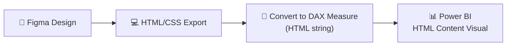

# HTML Content, Deneb e visuais customizados

> Extraído de `pbir_research_and_learnings.md` (aprendizados práticos em projetos TJBA). Seções mantidas na íntegra; a numeração original foi preservada.

## Índice

- 7. HTML Content Visual — Deep Dive
- 10. Useful DAX Patterns for Code Generation
- 11. HTML Content Visual — Template (Extracted from PBI Desktop)
- 12. Custom Visual Registration in report.json
- 14. Using SVG Icon Libraries (Lucide / Heroicons / Feather)
- 15. Responsive / Dynamic Sizing in HTML Content Visuals
- 16. HTML-to-DAX Conversion Patterns
- 17. Card Design Catalog (7 Proven Designs)
- 20. CSS Animations in HTML Content Visual
- 21. Deneb Visual — Interactive Custom Visuals (Research)
- 22. Deneb Spec Escaping — The #1 Gotcha
- 25. Deneb vs HTML+CSS vs Standard Visuals — Decision Guide

---

## 7. HTML Content Visual — Deep Dive

### Available Visuals (4 Options)

| Visual | Developer | Certified | External URLs | Export PDF/PPT |
|--------|-----------|-----------|---------------|----------------|
| **HTML Content (Lite)** | Daniel Marsh-Patrick | ✅ Yes | ❌ No | ✅ Yes |
| **HTML Content (Regular)** | Daniel Marsh-Patrick | ❌ No | ✅ Yes | ❌ No |
| **HTML VizCreator Cert** | BI Samurai | ✅ Yes | ❌ No | ✅ Yes |
| **HTML VizCreator Flex** | BI Samurai | ❌ No | ✅ Yes | ❌ No |

> [!TIP]
> For the **Figma → HTML/CSS → Power BI** workflow, start with **HTML Content (Regular)** for maximum flexibility. Switch to Lite/Cert for production reports that need PDF export.

### Supported CSS Features

Since the visual renders in a **browser sandbox**, it supports virtually all modern CSS:

| Feature | Supported | Notes |
|---------|-----------|-------|
| **Flexbox** | ✅ | Full support for layouts |
| **CSS Grid** | ✅ | Complex grid layouts work |
| **Gradients** | ✅ | `linear-gradient`, `radial-gradient` |
| **Box Shadows** | ✅ | `box-shadow` for depth effects |
| **Border Radius** | ✅ | Rounded corners |
| **CSS Animations** | ✅ | `@keyframes`, `transition` |
| **Custom Fonts** | ⚠️ | Inline `@font-face` with data URLs only (certified) |
| **SVG** | ✅ | All tags except `<use>`, `<script>`, `<foreignObject>` |
| **Images** | ⚠️ | Data URLs only (certified) / External URLs (uncertified) |
| **Backdrop Filter** | ✅ | Glassmorphism effects |
| **CSS Variables** | ✅ | `var(--custom-prop)` |

### Supported HTML Tags (Lite/Certified)

`<a>`, `<div>`, `<span>`, `<p>`, `<h1>`-`<h6>`, `<table>`, `<tr>`, `<td>`, `<th>`,
`<ul>`, `<ol>`, `<li>`, `` (data URLs), `<br>`, `<hr>`, `<strong>`, `<em>`,
`<b>`, `<i>`, `<u>`, `<code>`, `<pre>`, `<blockquote>`, `<sub>`, `<sup>`, all SVG tags

### Limitations

- **Sandbox**: Runs in an iframe with `null://` origin — no access to `powerbi.com` DOM
- **CORS**: Cannot embed content from sites with CORS restrictions
- **PBI Desktop vs Service**: Rendering may differ (Desktop is not a full browser)
- **Performance**: Re-renders entirely on every slicer/filter change
- **No JavaScript**: Cannot execute `<script>` tags (security)
- **No external URLs** in certified versions (images must be base64 data URLs)
- `<a href="#bookmark">` links don't work (sandbox has no origin)

### How Data Flows: DAX → HTML

```
DAX Measure → returns HTML string → HTML Content visual renders it
```

The visual accepts **one field** that contains an HTML string. This can be:
1. A DAX **measure** that builds HTML dynamically from data
2. A **column** in a table containing pre-built HTML strings
3. A **calculated column** combining data + HTML formatting

### Figma → HTML/CSS → Power BI Workflow



**Step-by-step:**
1. Design the visual card/component in **Figma**
2. Export as **HTML/CSS** (manually or via Figma plugins)
3. Convert the HTML to a **DAX measure** that returns the HTML string
4. Parameterize the HTML with DAX expressions (swap hardcoded values with `FORMAT([Measure], ...)`)
5. Add the **HTML Content visual** to your report
6. Bind the DAX measure to the visual's data field
7. Extract the resulting `visual.json` as a **template for code generation**

---

## 10. Useful DAX Patterns for Code Generation

### Calculated table with sample data
```dax
DATATABLE(
    "Column1", STRING,
    "Column2", DOUBLE,
    {
        {"value1", 100},
        {"value2", 200}
    }
)
```

### HTML measure for HTML Content visual
```dax
"<div style='...'>" &
"<h2>" & FORMAT([Measure], "#,##0") & "</h2>" &
"</div>"
```

---

## 11. HTML Content Visual — Template (Extracted from PBI Desktop)

> [!IMPORTANT]
> This is the exact JSON that Power BI Desktop generates for the HTML Content visual. Use this as a reusable template for code generation.

### visual.json Template
```json
{
  "$schema": "https://developer.microsoft.com/json-schemas/fabric/item/report/definition/visualContainer/2.6.0/schema.json",
  "name": "YOUR_UNIQUE_ID_HERE",
  "position": {
    "x": 40,
    "y": 310,
    "z": 2001,
    "height": 180,
    "width": 280,
    "tabOrder": 2001
  },
  "visual": {
    "visualType": "htmlContent443BE3AD55E043BF878BED274D3A6855",
    "query": {
      "queryState": {
        "content": {
          "projections": [
            {
              "field": {
                "Measure": {
                  "Expression": {
                    "SourceRef": {
                      "Entity": "TABLE_NAME"
                    }
                  },
                  "Property": "MEASURE_NAME"
                }
              },
              "queryRef": "TABLE_NAME.MEASURE_NAME",
              "nativeQueryRef": "MEASURE_NAME"
            }
          ]
        }
      }
    },
    "visualContainerObjects": {
      "background": [
        {
          "properties": {
            "show": {
              "expr": { "Literal": { "Value": "true" } }
            },
            "transparency": {
              "expr": { "Literal": { "Value": "100D" } }
            }
          }
        }
      ]
    },
    "drillFilterOtherVisuals": true
  }
}
```

Key differences from built-in card visual:
- `visualType`: `htmlContent443BE3AD55E043BF878BED274D3A6855` (unique ID for the public visual)
- Query role: `content` (not `Values` like cards)
- Has `nativeQueryRef` in projections
- Background transparency: `100D` (fully transparent — the HTML provides its own background)
- Has `drillFilterOtherVisuals: true`

---

## 12. Custom Visual Registration in report.json

Custom visuals (from AppSource marketplace) are registered in `report.json`:

```json
{
  "publicCustomVisuals": [
    "htmlContent443BE3AD55E043BF878BED274D3A6855"
  ]
}
```

> [!IMPORTANT]
> To programmatically add an HTML Content visual, you must ALSO add the visual type ID to the `publicCustomVisuals` array in `report.json`. Without this, PBI won't recognize the visual type.

The visual type ID format: `htmlContent` + `443BE3AD55E043BF878BED274D3A6855` (AppSource GUID).

### Resource Packages (Images, Themes) in report.json

```json
{
  "resourcePackages": [
    {
      "name": "SharedResources",
      "type": "SharedResources",
      "items": [{
        "name": "CY24SU06",
        "path": "BaseThemes/CY24SU06.json",
        "type": "BaseTheme"
      }]
    },
    {
      "name": "RegisteredResources",
      "type": "RegisteredResources",
      "items": [
        { "name": "MyImage123456789.png", "path": "MyImage123456789.png", "type": "Image" },
        { "name": "MyTheme5193027847108278.json", "path": "MyTheme5193027847108278.json", "type": "Image" }
      ]
    }
  ]
}
```

- `SharedResources`: Base themes stored in `StaticResources/SharedResources/BaseThemes/`
- `RegisteredResources`: Custom images + themes stored in `StaticResources/RegisteredResources/`
- Image files referenced via `ResourcePackageItem` in image visual `objects.general.imageUrl`

---

## 14. Using SVG Icon Libraries (Lucide / Heroicons / Feather)

> [!TIP]
> Inline SVG icons are the **best replacement for emojis** in HTML Content visuals. They're crisp, scalable, color-customizable, and work in both certified and uncertified versions.

### Why SVG icons > Emojis
- ✅ Consistent rendering across PBI Desktop and Service
- ✅ Color-customizable via `stroke` attribute
- ✅ Scales perfectly at any size
- ✅ Works in certified HTML Content (Lite)
- ❌ Emojis can look different across OS/browsers

### Template: Inline SVG Icon
```html
<svg width='16' height='16' viewBox='0 0 24 24'
  fill='none' stroke='#A78BFA' stroke-width='2'
  stroke-linecap='round' stroke-linejoin='round'>
  <!-- path data here -->
</svg>
```

### Icon Reference (Lucide icons used in our cards)

| Icon | Name | SVG Path | Used In |
|------|------|----------|---------|
| 💲 | DollarSign | `<line x1='12' y1='1' x2='12' y2='23'/><path d='M17 5H9.5a3.5 3.5 0 0 0 0 7h5a3.5 3.5 0 0 1 0 7H6'/>` | HtmlGlassCard |
| 👥 | Users | `<path d='M16 21v-2a4 4 0 0 0-4-4H6a4 4 0 0 0-4 4v2'/><circle cx='9' cy='7' r='4'/><path d='M22 21v-2a4 4 0 0 0-3-3.87'/><path d='M16 3.13a4 4 0 0 1 0 7.75'/>` | HtmlNeonCard |
| 🎯 | Target | `<circle cx='12' cy='12' r='10'/><circle cx='12' cy='12' r='6'/><circle cx='12' cy='12' r='2'/>` | HtmlProgressCard |
| 📊 | BarChart2 | `<line x1='18' y1='20' x2='18' y2='10'/><line x1='12' y1='20' x2='12' y2='4'/><line x1='6' y1='20' x2='6' y2='14'/>` | HtmlSparkCard |
| 💓 | Activity | `<polyline points='22 12 18 12 15 21 9 3 6 12 2 12'/>` | HtmlStatusCard |
| ✓ | Check | `<polyline points='20 6 9 17 4 12'/>` | HtmlGaugeCard |

### DAX Pattern: Icon + Label
```dax
"<div style='display:flex; align-items:center; gap:8px;'>" &
"<svg width='16' height='16' viewBox='0 0 24 24' fill='none' stroke='#A78BFA' stroke-width='2' stroke-linecap='round'>" &
"<line x1='12' y1='1' x2='12' y2='23'/>" &
"<path d='M17 5H9.5a3.5 3.5 0 0 0 0 7h5a3.5 3.5 0 0 1 0 7H6'/>" &
"</svg>" &
"<span style='font-size:11px; color:rgba(255,255,255,0.5);'>Receita</span></div>"
```

### Component Libraries in HTML Content Visual

| Library | Works? | Notes |
|---------|--------|-------|
| **Lucide SVG** | ✅ | Inline paths, no CDN needed |
| **Animate.css** | ✅ | Paste `@keyframes` in `<style>` block |
| **Google Fonts** | ⚠️ | `@import url(...)` — uncertified only |
| **Bootstrap CSS** | ⚠️ | Inline the CSS — no JS components |
| React/Vue/Angular | ❌ | Require JavaScript (blocked in sandbox) |
| D3.js / Chart.js | ❌ | Require JavaScript |

---

## 15. Responsive / Dynamic Sizing in HTML Content Visuals

> [!CAUTION]
> **MANDATORY RULE**: ALL HTML Content visuals must ALWAYS use responsive sizing. Never use fixed `px` values alone. Always wrap with `min()`, `clamp()`, or use viewport units.

> [!IMPORTANT]
> The HTML Content visual renders inside its own **iframe**. This means `100vh` = full visual height and `100vw` = full visual width. Use these to make HTML fill any container size.

### The Responsive Root Container (Required for EVERY card)
```css
/* ALWAYS start every card with this on the root div */
width: 100%;
height: 100vh;
box-sizing: border-box;
display: flex;
flex-direction: column;
justify-content: center;    /* or align-items:center for horizontal */
padding: min(24px, 4vh) min(24px, 4vw);
```

### CSS Functions Reference

| Function | Syntax | Best For |
|----------|--------|----------|
| `min()` | `min(28px, 6vw)` | Cap max size — shrinks on small containers |
| `max()` | `max(12px, 2vw)` | Cap min size — grows on large containers |
| `clamp()` | `clamp(10px, 3vw, 20px)` | Both min and max bounds |
| `100vh` | `height: 100vh` | Fill full container height |
| `100vw` | `width: 100vw` | Fill full container width |

### DAX Example: Responsive Gauge Card
```dax
"<div style='...height:100vh; display:flex; flex-direction:column; justify-content:center;'>" &
"<div style='width:min(120px,30vw,30vh); height:min(120px,30vw,30vh);'>" &
"<svg width='100%' height='100%' viewBox='0 0 120 120'>...</svg>" &
"</div></div>"
```

**Key**: SVG with `width='100%' height='100%'` + `viewBox` scales perfectly at any size.

---

## 16. HTML-to-DAX Conversion Patterns

### Conversion Checklist
1. ✅ Use **single quotes** for all HTML attributes (`style='...'` not `style="..."`)
2. ✅ Each line → a DAX string concatenated with `&`
3. ✅ Replace hardcoded values with `FORMAT([Measure], "pattern")`
4. ✅ CSS classes → **inline styles** (or use `<style>` block for animations)
5. ✅ `::before`/`::after` → nested `<div>` elements
6. ✅ `:hover` effects → **don't work** in PBI (no JS for interactions)
7. ✅ Wrap measure in `VAR`/`RETURN` for readability

### DAX String Escaping Rules

| Character | In DAX String | Notes |
|-----------|--------------|-------|
| Double quote `"` | `""` | Doubled inside DAX strings |
| Single quote `'` | `'` | Works normally — **use for HTML** |
| Ampersand `&` | `&` (in HTML) / `&` (DAX concat) | Context matters |
| Line break | Not needed | HTML ignores whitespace |

### Template: Complete DAX HTML Measure
```tmdl
	measure HtmlMyCard =
			VAR _valor = [MyMeasure]
			VAR _meta = 1000
			VAR _percent = DIVIDE(_valor, _meta, 0) * 100
			RETURN
			"<div style='font-family:Segoe UI,sans-serif; background:#12121F; border-radius:16px; padding:24px; color:white; width:100%; height:100vh; box-sizing:border-box; display:flex; flex-direction:column; justify-content:center;'>" &
			"<p style='margin:0 0 8px; font-size:12px; color:#6B7280;'>Label</p>" &
			"<div style='font-size:28px; font-weight:700;'>" & FORMAT(_valor, "#,##0") & "</div>" &
			"<div style='background:rgba(255,255,255,0.06); border-radius:6px; height:8px; margin-top:12px;'>" &
			"<div style='height:100%; border-radius:6px; background:linear-gradient(90deg,#8B5CF6,#06B6D4); width:" & FORMAT(_percent, "0") & "%;'></div></div>" &
			"</div>"
		lineageTag: XXXXXXXX-XXXX-XXXX-XXXX-XXXXXXXXXXXX
```

### Common FORMAT Patterns
| Format | Example | Output |
|--------|---------|--------|
| `"#,##0"` | `FORMAT(1250000, "#,##0")` | `1.250.000` |
| `"0.0"` | `FORMAT(94.5, "0.0")` | `94,5` |
| `"0"` | `FORMAT(85.7, "0")` | `86` |
| `"R$ #,##0"` | `FORMAT(1250000, "R$ #,##0")` | `R$ 1.250.000` |
| `"0.0%"` | `FORMAT(0.945, "0.0%")` | `94,5%` |

---

## 17. Card Design Catalog (7 Proven Designs)

All designs tested and working in Power BI HTML Content visual:

### 1. Glassmorphism Card
- **Look**: Frosted glass, radial gradient glow, gradient text
- **CSS**: `backdrop-filter:blur(20px)`, `rgba` backgrounds, `-webkit-background-clip:text`
- **Measure**: `HtmlGlassCard`

### 2. Neon Glow Card
- **Look**: Bottom gradient bar, icon circle, percentage badge
- **CSS**: `linear-gradient` bottom bar via `position:absolute; bottom:0`, rounded icon with `box-shadow` glow
- **Measure**: `HtmlNeonCard`

### 3. Progress Bar Card
- **Look**: Horizontal progress bar, percentage, remaining info
- **CSS**: Nested `<div>` with `width:N%`, `linear-gradient` fill, `flexbox` meta row
- **Measure**: `HtmlProgressCard`

### 4. Sparkline Card
- **Look**: Mini bar chart, trend indicator
- **CSS**: `flexbox` with `align-items:flex-end`, each bar `height:N%`, `linear-gradient(to top, ...)`
- **Measure**: `HtmlSparkCard`

### 5. Status Grid Card
- **Look**: Pulsing dot, 2×2 metrics grid
- **CSS**: `@keyframes` animation, `display:grid; grid-template-columns:1fr 1fr`
- **Measure**: `HtmlStatusCard`
- **Note**: Uses `<style>` block for `@keyframes` — works in uncertified version

### 6. SVG Gauge Ring
- **Look**: Circular progress ring, percentage center
- **CSS/SVG**: `stroke-dasharray` + `stroke-dashoffset` for arc, `linearGradient` for color
- **Math**: `dashoffset = 339.292 × (1 - percent/100)` where `339.292 = 2πr` (r=54)
- **Measure**: `HtmlGaugeCard`

### 7. Original Gradient Card
- **Look**: Purple gradient background, progress bar, meta text
- **CSS**: `linear-gradient(135deg, ...)`, `box-shadow` for depth
- **Measure**: `HtmlCardReceita`

### Design System — Color Palette

| Role | Color | Hex |
|------|-------|-----|
| Page Background | Very dark | `#0F0F1A` or `#1B1B2F` |
| Card Background | Dark blue | `#12121F` or `#162447` |
| Card Border | Subtle | `#1E1E3A` or `rgba(255,255,255,0.04)` |
| Primary Text | White | `#FFFFFF` |
| Secondary Text | Muted | `#9CA3AF` or `#6B7280` |
| Accent Purple | Violet | `#8B5CF6` or `#6366F1` |
| Accent Cyan | Teal | `#06B6D4` or `#00D9FF` |
| Accent Green | Success | `#4ADE80` |
| Accent Red | Error | `#F87171` |
| Accent Gold | Warning | `#FFD700` |
| Accent Pink | Highlight | `#EC4899` or `#E43F5A` |

---

## 20. CSS Animations in HTML Content Visual

> [!TIP]
> CSS animations work perfectly in the HTML Content visual! Use a `<style>` block at the top of the HTML string for `@keyframes` and class definitions, then reference classes in the HTML body.

### Animation Techniques That Work

| Technique | @keyframes | Best For |
|-----------|-----------|----------|
| **Rotating gradient border** | `borderRotate` | Eye-catching card borders |
| **Glow pulse** | `glowPulse` | Highlighting key numbers |
| **Fill bar** | `fillBar` | Progress bars that animate on load |
| **Fade-in slide up** | `fadeSlideUp` | Staggered element reveals |
| **Breathing background** | `breathe` | Subtle "alive" card backgrounds |
| **Shimmer** | `shimmer` | Loading skeleton effects |
| **SVG ring draw** | `drawRing` | Animated circular gauges |
| **Pulse dot** | `pulse` | Status indicators |

### Reusable @keyframes Library

```css
/* 1. Rotating gradient border — shifts gradient position */
@keyframes borderRotate {
  0% { background-position: 0% 50%; }
  50% { background-position: 100% 50%; }
  100% { background-position: 0% 50%; }
}

/* 2. Glow pulse — text shadow intensity */
@keyframes glowPulse {
  0%, 100% { text-shadow: 0 0 20px rgba(99,102,241,0.3); }
  50% { text-shadow: 0 0 40px rgba(99,102,241,0.8), 0 0 60px rgba(99,102,241,0.4); }
}

/* 3. Fill bar — width from 0% to target */
@keyframes fillBar { from { width: 0%; } }

/* 4. Fade-in slide up — opacity + translateY */
@keyframes fadeSlideUp {
  from { opacity: 0; transform: translateY(10px); }
  to { opacity: 1; transform: translateY(0); }
}

/* 5. Breathing background — gradient position shift */
@keyframes breathe {
  0%, 100% { background-position: 0% 50%; opacity: 0.8; }
  50% { background-position: 100% 50%; opacity: 1; }
}

/* 6. Shimmer — loading skeleton effect */
@keyframes shimmer {
  0% { background-position: -200% 0; }
  100% { background-position: 200% 0; }
}

/* 7. Pulse dot — scale + opacity for status indicators */
@keyframes pulse {
  0%, 100% { opacity: 1; transform: scale(1); }
  50% { opacity: 0.6; transform: scale(0.8); }
}

/* 8. SVG ring draw — stroke-dashoffset from full to target */
@keyframes drawRing { from { stroke-dashoffset: 339.292; } }
```

### DAX Pattern: Animated Card with `<style>` Block

```tmdl
measure HtmlAnimatedCard =
    VAR _val = [MyMeasure]
    RETURN
    "<style>" &
    "@keyframes fb{from{width:0%}}" &
    "@keyframes gp{0%,100%{text-shadow:0 0 20px rgba(99,102,241,0.3)}50%{text-shadow:0 0 40px rgba(99,102,241,0.8)}}" &
    ".ab{animation:fb 1.5s ease-out forwards}" &
    ".gn{animation:gp 2s ease-in-out infinite}" &
    "</style>" &
    "<div style='...'>" &
    "<div class='gn'>" & FORMAT(_val, "#,##0") & "</div>" &
    "<div class='ab' style='width:" & FORMAT(_val, "0") & "%;...'></div>" &
    "</div>"
```

### Staggered Animations with `animation-delay`

Apply different delays to create sequential reveal effects:
```html
<div class='anim-row' style='animation-delay:0.2s;'>Row 1</div>
<div class='anim-row' style='animation-delay:0.4s;'>Row 2</div>
<div class='anim-row' style='animation-delay:0.6s;'>Row 3</div>
```

### Rotating Gradient Border Pattern

The most eye-catching effect — a border that shifts colors continuously:
```html
<!-- Outer wrapper: the gradient border -->
<div style='padding:2px; border-radius:20px;
  background:linear-gradient(270deg,#6366F1,#06B6D4,#EC4899,#8B5CF6);
  background-size:300% 300%;
  animation:borderRotate 4s ease infinite;'>
  <!-- Inner card: solid dark background -->
  <div style='background:#12121F; border-radius:18px; padding:24px;'>
    Content here
  </div>
</div>
```

> [!WARNING]
> **Important notes about animations in PBI:**
> - Animations replay every time the visual re-renders (slicer change, filter, etc.)
> - `<style>` blocks with `@keyframes` require the **uncertified** HTML Content visual (not Lite)
> - Use `animation-fill-mode: forwards` for one-shot animations (bars stay at target width)
> - Use `infinite` for continuous effects (glow, breathing, rotating border)
> - Keep animation names short in DAX to reduce string length

---

## 21. Deneb Visual — Interactive Custom Visuals (Research)

> [!IMPORTANT]
> **Deneb** is a free, open-source (MIT) custom visual that lets you create fully interactive data visualizations using **Vega** or **Vega-Lite** JSON specifications. It supports **cross-filtering**, **tooltips**, and **selections** — unlike the HTML Content visual.

### Key Differences: HTML Content vs Deneb

| Feature | HTML Content | Deneb |
|---------|-------------|-------|
| **Rendering** | HTML/CSS in iframe | Vega/Vega-Lite (SVG/Canvas) |
| **Cross-filtering** | ❌ None | ✅ Full support |
| **Tooltips** | ❌ CSS only | ✅ PBI native tooltips |
| **Click selection** | ❌ No JS | ✅ Via `__selected__` field |
| **Animations** | ✅ CSS @keyframes | ⚠️ Limited (transitions only) |
| **Custom layout** | ✅ Full HTML/CSS | ⚠️ Chart-focused |
| **Spec language** | HTML string in DAX | Vega-Lite JSON |
| **AI agent friendly** | ✅ DAX string gen | ✅ Pure JSON gen |
| **Free** | ✅ Yes | ✅ Yes (MIT) |
| **AppSource** | ✅ Yes | ✅ Yes |

### Cross-Filtering Architecture

1. Enable "Expose cross-filtering values for dataset rows" in visual settings
2. Deneb adds a `__selected__` field to each data row
3. Use `__selected__` to encode opacity/color (selected vs dimmed)
4. Clicks on marks automatically filter other visuals on the page

```json
{
  "encoding": {
    "opacity": {
      "condition": {"test": {"field": "__selected__", "equal": "on"}, "value": 1},
      "value": 0.3
    }
  }
}
```

### Vega-Lite Spec Format (What AI Generates)

```json
{
  "$schema": "https://vega.github.io/schema/vega-lite/v5.json",
  "data": {"name": "dataset"},
  "mark": {"type": "bar", "cornerRadiusTopLeft": 4, "cornerRadiusTopRight": 4},
  "encoding": {
    "x": {"field": "Categoria", "type": "nominal"},
    "y": {"field": "Valor", "type": "quantitative"},
    "color": {"field": "Categoria", "type": "nominal"},
    "opacity": {
      "condition": {"test": {"field": "__selected__", "equal": "on"}, "value": 1},
      "value": 0.3
    },
    "tooltip": [
      {"field": "Categoria", "type": "nominal"},
      {"field": "Valor", "type": "quantitative", "format": ",.0f"}
    ]
  }
}
```

### PBIP Integration (Confirmed from actual visual.json)

> [!IMPORTANT]
> We extracted and validated the exact Deneb PBIP structure. The Vega-Lite spec is stored as an escaped JSON string inside `objects.vega[].properties.jsonSpec`.

#### Query Role Name
- Deneb uses a **single role** called `dataset` (not `Values`/`Category` like built-in visuals)
- All fields (columns + measures) go into the same `dataset` projections array

#### Spec Storage
```
objects.vega[0].properties.jsonSpec.expr.Literal.Value = "'{ escaped JSON string }'"
```
- The JSON spec is **escaped** (quotes become `\"`, newlines become `\n`)
- The entire string is wrapped in **single quotes**: `"'{ ... }'"` (same pattern as colors!)

#### Full visual.json Template (Reusable)
```json
{
  "$schema": "https://developer.microsoft.com/json-schemas/fabric/item/report/definition/visualContainer/2.6.0/schema.json",
  "name": "YOUR_UNIQUE_ID",
  "position": { "x": 30, "y": 480, "z": 7000, "height": 220, "width": 390, "tabOrder": 7000 },
  "visual": {
    "visualType": "deneb7E15AEF80B9E4D4F8E12924291ECE89A",
    "query": {
      "queryState": {
        "dataset": {
          "projections": [
            {
              "field": { "Column": { "Expression": { "SourceRef": { "Entity": "TABLE" } }, "Property": "COLUMN_NAME" } },
              "queryRef": "TABLE.COLUMN_NAME", "nativeQueryRef": "COLUMN_NAME"
            },
            {
              "field": { "Measure": { "Expression": { "SourceRef": { "Entity": "TABLE" } }, "Property": "MEASURE_NAME" } },
              "queryRef": "TABLE.MEASURE_NAME", "nativeQueryRef": "MEASURE_NAME"
            }
          ]
        }
      }
    },
    "objects": {
      "stateManagement": [{ "properties": {
        "viewportHeight": { "expr": { "Literal": { "Value": "220D" } } },
        "viewportWidth": { "expr": { "Literal": { "Value": "390D" } } }
      }}],
      "editor": [{ "properties": {
        "previewScrollbars": { "expr": { "Literal": { "Value": "false" } } },
        "theme": { "expr": { "Literal": { "Value": "'dark'" } } }
      }}],
      "vega": [{ "properties": {
        "provider": { "expr": { "Literal": { "Value": "'vegaLite'" } } },
        "jsonSpec": { "expr": { "Literal": { "Value": "'ESCAPED_VEGALITE_JSON'" } } },
        "jsonConfig": { "expr": { "Literal": { "Value": "'{}'" } } },
        "isNewDialogOpen": { "expr": { "Literal": { "Value": "false" } } },
        "enableTooltips": { "expr": { "Literal": { "Value": "true" } } },
        "enableContextMenu": { "expr": { "Literal": { "Value": "true" } } },
        "enableHighlight": { "expr": { "Literal": { "Value": "true" } } },
        "enableSelection": { "expr": { "Literal": { "Value": "true" } } },
        "selectionMaxDataPoints": { "expr": { "Literal": { "Value": "50D" } } },
        "selectionMode": { "expr": { "Literal": { "Value": "'simple'" } } },
        "version": { "expr": { "Literal": { "Value": "'6.4.1'" } } }
      }}]
    },
    "visualContainerObjects": {
      "padding": [{ "properties": {
        "top": { "expr": { "Literal": { "Value": "0D" } } },
        "left": { "expr": { "Literal": { "Value": "0D" } } },
        "bottom": { "expr": { "Literal": { "Value": "0D" } } },
        "right": { "expr": { "Literal": { "Value": "0D" } } }
      }}]
    },
    "drillFilterOtherVisuals": true
  }
}
```

#### Interactivity Flags (all in `objects.vega[].properties`)

| Property | Value | Effect |
|----------|-------|--------|
| `enableTooltips` | `true` | Native PBI tooltips on hover |
| `enableContextMenu` | `true` | Right-click context menu |
| `enableHighlight` | `true` | Cross-highlight from other visuals |
| `enableSelection` | `true` | Click-to-select (cross-filtering) |
| `selectionMaxDataPoints` | `50D` | Max selectable points (1-250) |
| `selectionMode` | `'simple'` | Simple or advanced selection |

#### Python Script: Escape Vega-Lite Spec for PBIP
```python
import json

def escape_spec_for_pbip(spec_dict):
    """Convert a Vega-Lite dict to the escaped string format PBIP expects."""
    json_str = json.dumps(spec_dict, indent=2)
    # Escape backslashes first, then quotes
    escaped = json_str.replace('\\', '\\\\').replace('"', '\\"').replace('\n', '\\n')
    return f"'{escaped}'"
```

*Last updated: 2026-03-06*

---

## 22. Deneb Spec Escaping — The #1 Gotcha

> [!CAUTION]
> **Never use `\\n` in Deneb jsonSpec strings!** They are treated as literal backslash-n characters, NOT whitespace. This causes `JSON parse error at position 1` in the Deneb editor.

### ❌ Wrong — `\\n` newlines (causes parse error)
```json
"Value": "'{\\n  \\\"$schema\\\": \\\"https://vega.github.io/schema/vega-lite/v5.json\\\",\\n  \\\"data\\\": ...}'"
```

### ✅ Correct — compact single-line JSON (no newlines)
```json
"Value": "'{\"$schema\": \"https://vega.github.io/schema/vega-lite/v5.json\", \"data\": {\"name\": \"dataset\"}, \"mark\": \"bar\", ...}'"
```

### Escaping Rules for Deneb jsonSpec in visual.json

| Character | In the file | What it becomes | Notes |
|-----------|------------|-----------------|-------|
| `"` (inner JSON quote) | `\"` | `"` | Standard escape |
| `'` (in expressions) | `\\u0027` | `'` | For filter expressions like `datum.Category === 'Device'` |
| Newlines | **DON'T USE** | — | Causes parse errors |
| The outer wrapper | `"'{...}'"` | `'{...}'` | Single-quoted string value |

### Python Script (Updated — NO newlines!)
```python
import json

def escape_spec_for_pbip(spec_dict):
    """Convert a Vega-Lite dict to the escaped string format PBIP expects."""
    # Compact single-line JSON — NO indent, NO newlines
    json_str = json.dumps(spec_dict, separators=(',', ': '))
    # Escape quotes for embedding in JSON Value string
    escaped = json_str.replace('"', '\\"')
    # Replace single quotes in expressions with unicode escape
    escaped = escaped.replace("'", "\\u0027")
    return f"'{escaped}'"
```

### First-Time Initialization Required

> [!WARNING]
> Deneb visuals created from JSON **require manual initialization**:
> 1. Open PBI Desktop, click on the blank Deneb visual
> 2. Click "..." → "Edit" to open the Deneb editor
> 3. The spec should be loaded — click **"Create"** or **"Apply"**
> 4. After this one-time step, the visual renders correctly going forward

This is NOT needed for HTML Content visuals — they render immediately.

---

## 25. Deneb vs HTML+CSS vs Standard Visuals — Decision Guide

### When to use each tool

| Use Case | Best Tool | Why |
|----------|-----------|-----|
| KPI cards, headers, info panels | **HTML+CSS** | Beautiful styling, CSS animations, easy to edit in DAX |
| Filter drawers, navigation panels | **HTML+CSS** + **Bookmarks** | Full CSS control + toggle via bookmark actions |
| Standard charts (bar, line, pie) | **Standard PBI visuals** | Native cross-filtering, zero overhead |
| Custom charts (Sankey, org tree, beeswarm) | **Deneb (Vega-Lite)** | Impossible with standard visuals |
| Animated data viz (bar chart race) | **Deneb (Vega)** | Only option, but very high complexity |
| Slicers and filters | **Standard PBI slicer** | Native cross-filtering, easy to style |

### Avoid These Anti-Patterns

- ❌ Using Deneb for simple bar/line charts (standard visuals do this better)
- ❌ Using HTML+CSS for data-driven charts (DAX string concat for chart paths is unmaintainable)
- ❌ Using `\\n` in Deneb jsonSpec values (causes parse errors)
- ❌ Using full Vega when Vega-Lite is sufficient (3-5x more code)
- ❌ Putting many Deneb visuals on one page (cold-start performance hit per visual)

### Deneb Animation: Vega vs Vega-Lite

| Feature | Vega-Lite | Vega |
|---------|-----------|------|
| Static charts | ✅ Simple | ✅ Verbose |
| Transitions on data change | ❌ None | ✅ Timer events |
| Bar chart race | ❌ Impossible | ✅ Yes (complex) |
| Particle effects | ❌ Impossible | ✅ Yes (complex) |
| Code complexity | Low (~30 lines) | High (100-500 lines) |
| IDE editability | Moderate | Difficult |

### Community Resources

| Resource | URL | Content |
|----------|-----|---------|
| Deneb Showcase (PBI-David) | github.com/PBI-David/Deneb-Showcase | 25+ examples with animated visuals |
| Deneb Official Docs | deneb-viz.github.io | Full documentation |
| Kerry Kolosko blog | kerrykolosko.com | PBI visualization tutorials |
| Vega-Lite Examples | vega.github.io/vega-lite/examples | Complete example gallery |

### Key Limitation: Deneb Sandbox

- Each Deneb visual runs in its **own isolated sandbox** (iframe)
- Multiple Deneb visuals = **cold-start delay** per visual on page load
- **10K row limit** by default (configurable but impacts performance)
- **No external URLs** — can't load fonts, images, or external data
- Certified by Microsoft — works in PBI Service, PDF export, email

---

